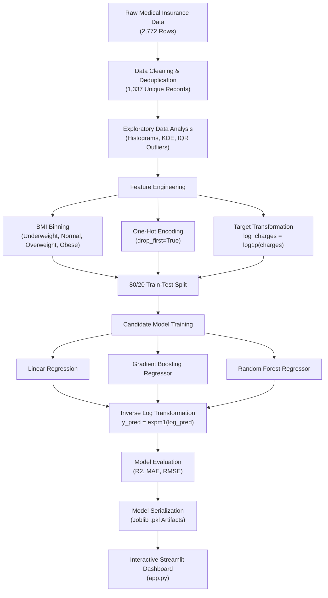

<div align="center">

# 🏥 Medical Insurance Cost Prediction & Clinical Estimator

[](https://www.python.org/)
[](https://scikit-learn.org/)
[](https://streamlit.io/)
[](https://pandas.pydata.org/)
[](https://opensource.org/licenses/MIT)
[](https://github.com/RISHII7/Insurance-Cost-Prediction)

**An end-to-end Machine Learning pipeline and interactive Streamlit web application that predicts personal medical insurance charges with over 86% accuracy ($R^2$), uncovering critical risk factors like BMI thresholds and smoking habits.**

[Explore App](#-interactive-web-application) • [Model Benchmark](#-model-evaluation--leaderboard) • [Quickstart](#-quickstart-guide) • [Architecture](#-machine-learning-pipeline)

</div>

---

## 📑 Table of Contents

- [Executive Summary](#-executive-summary)
- [Machine Learning Pipeline](#-machine-learning-pipeline)
- [Dataset & Feature Engineering](#-dataset--feature-engineering)
- [Exploratory Data Analysis (EDA) Insights](#-exploratory-data-analysis-eda-insights)
- [Model Evaluation & Leaderboard](#-model-evaluation--leaderboard)
- [Interactive Web Application](#-interactive-web-application)
- [Repository Structure](#-repository-structure)
- [Quickstart Guide](#-quickstart-guide)
- [Model Inference Code](#-how-to-use-the-saved-model)
- [License & Author](#-license--author)

---

## 🌟 Executive Summary

Healthcare premium forecasting is essential for actuarial underwriting, personalized patient financial planning, and risk assessment. Medical charges are typically non-linear, heavily right-skewed, and driven by complex interactions between biometric markers and lifestyle behaviors.

This project delivers:
1. **Robust Data Preprocessing**: Cleaned raw dataset by dropping 1,435 duplicate records to avoid data leakage and evaluation bias.
2. **Feature Engineering**: Formulated custom WHO-standard BMI categories and normalized the right-skewed target variable using $\log(1+x)$ transformation.
3. **Model Optimization**: Benchmarked baseline linear models against ensemble learning algorithms (Random Forest & Gradient Boosting).
4. **Superior Performance**: Achieved an **$R^2$ Score of ~0.8609** and an **MAE of ~$1,946.66** with Random Forest on inverted real dollar scales.
5. **Production Deployment**: Shipped a responsive, two-column Streamlit web dashboard allowing instant insurance estimations and comparative analysis against demographic averages.

---

## 🔄 Machine Learning Pipeline



---

## 📊 Dataset & Feature Engineering

The dataset consists of patient demographic and lifestyle attributes:

| Feature | Data Type | Range / Categories | Description |
|---|---|---|---|
| `age` | Integer | 18 – 64 | Age of primary beneficiary |
| `sex` | Categorical | `female`, `male` | Insurance contractor gender |
| `bmi` | Float | 15.0 – 55.0 | Body Mass Index ($kg/m^2$), objective weight indicator |
| `children` | Integer | 0 – 5 | Number of dependents covered by insurance |
| `smoker` | Categorical | `yes`, `no` | Smoking status of the beneficiary |
| `region` | Categorical | `northeast`, `northwest`, `southeast`, `southwest` | Residential region in the US |
| **`charges`** | **Float** | **$1,121.87 – $63,770.43** | **Target variable**: Annual medical expenses billed |

### 🧠 Feature Engineering Highlights:
- **BMI Categorization**: Segmented BMI into WHO clinical categories:
  $$\text{Category} = \begin{cases} \text{underweight} & \text{BMI} < 18.5 \\ \text{normal} & 18.5 \le \text{BMI} < 25 \\ \text{overweight} & 25 \le \text{BMI} < 30 \\ \text{obese} & \text{BMI} \ge 30 \end{cases}$$
- **One-Hot Encoding**: Converted categorical columns (`sex`, `smoker`, `region`, `bmi_category`) with `drop_first=True` to eliminate the dummy variable trap and avoid multicollinearity.
- **Log Target Transformation**: Because raw medical charges exhibit strong positive skewness (**1.51**), applying $\log(1 + \text{charges})$ reduced skewness down to **0.09**, stabilizing residual variance for regressor convergence.

---

## 🔍 Exploratory Data Analysis (EDA) Insights

1. **The Smoker Premium Multiplier**:
   - **Non-smoker Mean**: $\approx \$8,400$
   - **Smoker Mean**: $\approx \$32,000$ (approx. **$4\times$ higher**)
2. **The BMI × Smoker Compounding Interaction**:
   - For non-smokers, higher BMI creates a mild, gradual increase in charges.
   - For smokers with $\text{BMI} \ge 30$ (obese), charges surge exponentially, consistently exceeding **$35,000 – $45,000+**.
3. **Outlier Detection via IQR**:
   - For `bmi`: Identified mild upper outliers beyond $47.3\ kg/m^2$ ($0.7\%$ of cases).
   - For `charges`: Found upper outliers beyond $\$34,489$ driven almost entirely by smokers with comorbidities.

---

## 🏆 Model Evaluation & Leaderboard

All models were evaluated on held-out test data. **Metrics are computed on the actual dollar scale ($\$)** by inverting predicted log charges via $e^x - 1$ (`np.expm1`):

| Rank | Model | $R^2$ Score | Mean Absolute Error (MAE) | Root Mean Squared Error (RMSE) | Status |
|:---:|---|:---:|:---:|:---:|:---:|
| 🥇 | **Random Forest Regressor** | **0.8609** | **$1,946.66** | **$4,229.31** | **Selected Best Model** |
| 🥈 | **Gradient Boosting Regressor** | 0.8458 | $2,125.39 | $4,452.35 | Competitive Alternative |
| 🥉 | **Linear Regression (Baseline)** | 0.4579 | $4,191.12 | $8,348.58 | Baseline Benchmark |

> **Key Takeaway**: Ensemble tree-based models capture the non-linear interaction between `bmi` and `smoker` exceptionally well, boosting explained variance from 45.8% up to **86.1%**, while cutting prediction errors by more than half.

---

## 💻 Interactive Web Application

A full-featured web app is built with **Streamlit** in `app.py`:

- **Responsive Two-Column Interface**: Patient details on the left, live visual estimates on the right.
- **Biometric Sliders & Radios**: Easy-to-use inputs for Age, BMI, Children, Sex, Smoking Status, and Region.
- **Dynamic Feature Vectorization**: Employs `build_input_row()` to guarantee zero-fill schema alignment with trained model feature columns.
- **Comparative Benchmark Analytics**: Automatically renders an interactive comparative bar chart contrasting the patient's predicted charge against the nationwide non-smoker average ($\$8,400$) and smoker average ($\$32,000$).

```text
┌───────────────────────────────────────┬────────────────────────────────────────┐
│ 🧑 Patient Details                    │ 💵 Estimated Charges                  │
│ ───────────────────────────────────── │ ────────────────────────────────────── │
│ Age: [───●───────] 30                 │  Predicted Annual Charge:              │
│ Sex: (•) Male  ( ) Female             │  $4,230.50                             │
│ BMI: [──────●────] 26.0               │                                        │
│ Children: [●─────────] 0              │  Comparative Analysis vs Benchmarks:   │
│ Smoker: (•) No  ( ) Yes               │   ■ Your Prediction:   $4,230.50       │
│ Region: [ Northwest ▼ ]               │   ■ Non-smoker Avg:    $8,400.00       │
│                                       │   ■ Smoker Avg:       $32,000.00       │
│ [ 🚀 Estimate Charges ]               │  [███░░░░░░░░░░░░░░░░░░░░░░░░░░░░░░░]   │
└───────────────────────────────────────┴────────────────────────────────────────┘
```

---

## 📂 Repository Structure

```text
├── .vscode/
│   └── settings.json          # Workspace Python interpreter & analysis configuration
├── .gitignore                 # Excludes virtual environments, bytecodes, and checkpoints
├── medical_insurance.csv      # Raw medical insurance dataset (2,772 rows)
├── main.ipynb                 # Fully annotated 40-cell Machine Learning Jupyter Notebook
├── app.py                     # Production-ready interactive Streamlit web dashboard
├── requirements.txt           # Curated, minimal project dependency manifest
├── insurance_model.pkl        # Serialized best trained Random Forest model
├── model_features.pkl         # Serialized list of feature matrix columns
├── model_name.pkl             # Serialized best model identifier metadata
└── README.md                  # Comprehensive project documentation
```

---

## 🚀 Quickstart Guide

### 1. Clone the Repository
```bash
git clone https://github.com/RISHII7/Insurance-Cost-Prediction.git
cd Insurance-Cost-Prediction
```

### 2. Create and Activate a Virtual Environment

**Windows:**
```powershell
python -m venv .venv
.\.venv\Scripts\activate
```

**macOS / Linux:**
```bash
python3 -m venv .venv
source .venv/bin/activate
```

### 3. Install Dependencies
```bash
pip install -r requirements.txt
```

### 4. Launch the Interactive Web App
```bash
streamlit run app.py
```
*Your browser will automatically open to `http://localhost:8501`.*

### 5. Explore the Jupyter Notebook
```bash
jupyter notebook main.ipynb
# or open main.ipynb in VS Code and select the .venv kernel
```

---

## 🔮 How to Use the Saved Model

You can load and make programmatic predictions using the serialized artifacts in just a few lines of Python:

```python
import joblib
import numpy as np
import pandas as pd

# 1. Load artifacts
model = joblib.load("insurance_model.pkl")
feature_cols = joblib.load("model_features.pkl")


# 2. Prepare sample patient data
def predict_insurance_cost(age, sex, bmi, children, smoker, region):
    # Determine BMI category
    if bmi < 18.5:
        category = "underweight"
    elif bmi < 25:
        category = "normal"
    elif bmi < 30:
        category = "overweight"
    else:
        category = "obese"

    row = {
        "age": age,
        "bmi": bmi,
        "children": children,
        "sex_male": 1 if sex == "male" else 0,
        "smoker_yes": 1 if smoker == "yes" else 0,
        "region_northwest": 1 if region == "northwest" else 0,
        "region_southeast": 1 if region == "southeast" else 0,
        "region_southwest": 1 if region == "southwest" else 0,
        "bmi_category_obese": 1 if category == "obese" else 0,
        "bmi_category_overweight": 1 if category == "overweight" else 0,
        "bmi_category_underweight": 1 if category == "underweight" else 0,
    }

    input_df = pd.DataFrame([row]).reindex(columns=feature_cols, fill_value=0)

    # Model predicts log_charges; invert with expm1
    log_prediction = model.predict(input_df)[0]
    return np.expm1(log_prediction)


# 3. Example prediction
estimated_cost = predict_insurance_cost(
    age=30, sex="male", bmi=26.5, children=1, smoker="no", region="northwest"
)

print(f"Estimated Annual Insurance Cost: ${estimated_cost:,.2f}")
```

---

## 📜 License & Author

Distributed under the **MIT License**. See `LICENSE` for more information.

Developed by **[RISHII7](https://github.com/RISHII7)**.  
Contributions, bug reports, and feature requests are welcome! Feel free to star ⭐ the repository if you found this project helpful.
